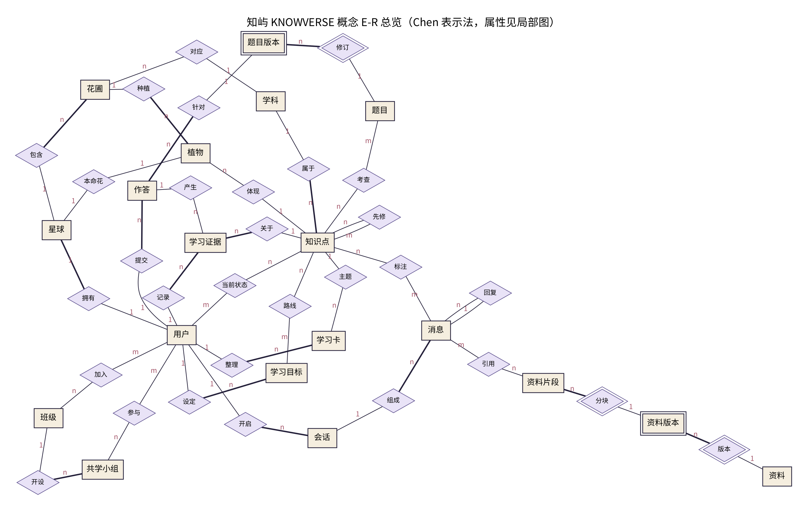

# 知屿 KNOWVERSE：基于学习记录与关系数据库的个人学习助手

**《数据库系统概论》大作业 · 实验报告（草稿）**

> 状态：**草稿，尚未经过团队审阅**。成员、分工与结论需要团队确认后填写或修改。文中数据均来自本仓库的实际运行结果；没有用户实验，不报告学习效果。

| 项 | 内容 |
|---|---|
| 小组成员 | （待填写，见 `docs/team-template.md`） |
| 选题 | 课程给定题目“个人学习助手” |
| 展示文案 | 在自己的星球上，养出属于你的花。 |
| 技术栈 | Next.js 15 + TypeScript（B/S 架构）、PostgreSQL 16、Drizzle ORM 与 migration、Zod、React Three Fiber / Three.js（含 SVG 降级） |

---

## 1 需求分析

### 1.1 背景

大模型可以解答疑难，但基于浏览器的对话工具不方便梳理与积累：问过的问题难以按知识点找回，回答依据什么资料不清楚，“聊过很多次”也不等于真正会做。课程要求开发一个结合数据管理知识的个人学习助手（附件第 3 页）。

### 1.2 功能需求

**必选（附件明确要求）**
- F1 个性化答疑：学生就课程内容与大模型对话，系统自动生成回复。
- F2 历史问答梳理：按时间、关键词、知识点等维度检索历史对话。

**推荐（附件列出）**
- F3 教学资料整理：PPT、习题等资料的元数据管理。
- F4 个性化训练：根据薄弱点出题。

**本组的细化**
- F1.1 回答结合当前目标、知识点与近期对话；引用资料时给出资料版本与页码/段落；依据不足时说明。
- F1.2 自动给问题打知识点候选标签，用户可确认、移除或添加；新概念只作为建议。
- F2.1 关键词覆盖会话标题、问题与回答；时间按用户时区的自然日；知识点可多选；任意组合；分页；匹配片段高亮。
- F2.2 点击结果回到原会话并定位原消息（保留前后文），可从原位置继续提问；从一株植物可进入它关联的全部问答。
- F3.1 资料上传后经过校验、提取、版本、分块、索引；PPTX 保存页号、PDF 保存页码；扫描件明确提示需要 OCR。
- F4.1 依据真实错题、成长阶段与待复习时间选题；新用户先诊断；SQL 题在独立只读数据集中执行判题。
- F5 学习成长：以证据驱动的“种子→嫩芽→生叶→花苞→开花”，区分自述、辅助、独立、团队四类证据。
- F6（增强）班级星系、学习卡、互补伙伴、共学小组。

### 1.3 非功能需求

| 类别 | 要求 |
|---|---|
| 一致性 | 证据、状态、历史与成长事件一致提交；作答重试只结算一次 |
| 权限 | 默认只能读取本人记录；权限条件写入 SQL |
| 安全 | Key 只在服务端；模型不能执行任意 SQL、不能改学习状态；资料内容不能覆盖系统指令 |
| 可用性 | 浏览器访问；桌面与手机布局；键盘可达；低动效；WebGL 不可用时有 SVG 界面 |
| 诚实 | 演示模式与真实模式明确区分；失败显示错误与重试，不用模拟内容冒充成功 |

### 1.4 世界隐喻与数据的对应

| 产品概念 | 数据 |
|---|---|
| 用户 → 一颗个人星球 | users 1:1 planets |
| 学科 / 主题 → 花圃 | gardens（星球 × 学科） |
| 知识点 → 一株植物 | concepts（知识）与 plants（外观实例）分离 |
| 学习目标 → 探索路线 | learning_goals + goal_concepts(route_order) |
| 提问、笔记、练习 → 植物档案中的记录 | messages、notes、attempts → learning_evidence |
| 学习成果 → 学习卡 | knowledge_cards + card_versions |
| 班级 → 星系 | classes + class_members |

## 2 概要设计

### 2.1 体系结构

```
浏览器（React 客户端组件：星球 3D/SVG、面板）
   │  HTTPS JSON（Cookie 会话）
Next.js Route Handlers（/api/*）── Zod 校验 ── 统一错误结构
   │
服务层 src/server
   ├─ chat.ts ── agent/（主智能体 + 工具注册表 + 提示词 + 演示/真实模型客户端）
   ├─ history.ts（组合检索）  materials.ts + extract/（资料流水线）
   ├─ practice.ts + sandbox.ts（选题、作答、判题）  growth.ts（成长规则）
   ├─ world.ts（星球、档案、时间轴）  classes.ts（增强）
   │
PostgreSQL 16：业务库 knowverse（44 表，pg_trgm）  ·  SQL 沙箱库 knowverse_sandbox（只读角色，数据集 school_v1）
```

主要设计决策：
1. **单体 B/S 应用**，不拆微服务；关系数据库为唯一权威来源。
2. **服务层 SQL 显式参数化**：Drizzle 定义模式并生成 migration；复杂查询用手写 SQL（便于在报告中解释与 EXPLAIN）。
3. **短事务**：模型调用、文件提取、沙箱执行都在事务之外。
4. **主智能体 + 工具**，不做多智能体。

### 2.2 模块划分

| 模块 | 职责 | 页面 |
|---|---|---|
| 身份 | 注册、登录、演示账号、Cookie 会话 | 首页 |
| 开场 | 目标 → 知识点确认 → 本命花 → 星球命名 | /welcome |
| 个人空间 | 星球、目标与花圃、成长时间轴 | /space |
| 对话 | 会话列表、提问、引用、标签、重试 | 对话面板 |
| 历史 | 组合检索、分页、定位 | 历史面板 |
| 资料温室 | 上传、版本、片段、候选概念 | 资料面板 |
| 练习 | 选题、作答、提示、判题、证据 | 练习面板 |
| 植物档案 | 阶段与依据、证据修正、关联问答 | 档案面板 |
| 增强 | 星系、学习卡、伙伴、小组 | 星系、学习卡面板 |

### 2.3 概念模型

教材风格 E-R 图见 `docs/er/`（总览 + 4 张局部图，Chen 表示法）。主要实体：用户、星球、花圃、植物、学科、知识点、学习目标、会话、消息、模型调用、资料、资料版本（弱）、资料片段（弱）、题目、题目版本（弱）、提示（弱）、作答、评价、学习证据、笔记、成长事件，以及增强部分的班级、学习意愿、共学小组、贡献、学习卡、卡片版本（弱）。



## 3 详细设计

### 3.1 数据库模式

关系模式图：`docs/schema/schema-core.svg`、`docs/schema/schema-enhanced.svg`。完整说明、约束与索引对应关系见 `docs/database-design.md`。

### 3.2 规范化与模式选择

（摘要，详见 `docs/database-design.md` §4）

1. **plants / concepts / learning_states 分解**：宽表 P(user_id, concept_id, concept_name, subject_id, species, …, stage) 中 concept_id → concept_name 是部分依赖（只满足 1NF），导致改名、插入与删除异常。分解后三个模式均为 BCNF；以 concept_id 为公共属性且为 concepts 的键，分解无损。
2. **messages.user_id 受控冗余**：id → conversation_id → user_id 为传递依赖，不满足严格 3NF；为了让历史检索的每条子查询都能直接以 user_id 过滤并使用 (user_id, created_at) 索引而保留，用复合外键保证与会话一致。
3. **引用只存 chunk_id**：片段属于不可变版本；不在引用表冗余 material_id / version_no / page_no，避免传递依赖与“页码对不上”的更新异常。
4. **learning_states 作为汇总**：阶段可由有效证据推导；为首页读取性能保留，规定只能在证据写入的同一事务中重算。
5. **state_history 与 growth_events 合并**：同为追加型事件流，拆表没有规范化收益。

### 3.3 关键流程

**个性化答疑**
1. 事务 1：保存用户消息与 `pending` 助手消息；若指定了知识点，写入 context 标签。
2. 事务外：识别请求 → get_learning_context → search_materials →（历史类）search_conversations →（练习类）create_practice → 生成回答（真实模型或演示逻辑）→ Zod 校验 → 引用校验 → 标签候选。
3. 事务 2：写回答、引用（chunk_id）、候选标签、概念建议；焦点知识点记一次“提问”证据并重算阶段。
4. 失败：消息置 `failed` 并记录 model_calls 错误码；“重试”只能认领 failed 消息。

**历史检索**：见 `docs/sql/core_queries.sql` Q1。三路候选（问题、回答、标题）UNION 后与问题消息 JOIN；时间条件 `created_at >= from AT TIME ZONE tz AND < (to+1) AT TIME ZONE tz`；知识点条件 EXISTS 子查询；`count(*) OVER ()` 返回总数；LIMIT/OFFSET 分页。

**作答提交**：快速幂等检查 → 事务外评价（沙箱 / 规则 / 公开维度）→ 事务内 `FOR UPDATE` 锁作答并二次检查 → 写评价、证据、状态、成长事件、outbox。唯一索引 (user_id, submit_key) 兜底并发。

**资料流水线**：校验（大小、扩展名与文件头、UTF-8）→ 事务 1 登记版本（processing）→ 事务外提取 → 事务 2 写片段与候选概念、更新状态（ready / needs_ocr / unsupported / failed）。

### 3.4 成长规则

| 阶段 | 依据 |
|---|---|
| 种子 | 确认了目标或知识点 |
| 嫩芽 | 阅读、提问或笔记 |
| 生叶 | 引导练习（注明使用过提示） |
| 花苞 | 独立作答（不论对错） |
| 开花 | 未使用提示、首次作答即正确的独立变式 |

自述理解与团队贡献单独记录、不推动阶段；熟题重复答对不算新的迁移证据；答错不退化；不登录不枯萎；修正证据保留历史并重算。阶段是产品记录，不是掌握程度的测量。

### 3.5 智能体与安全

见 `docs/agent.md`。工具声明输入/输出结构、权限、超时；模型只能调用只读工具；写入由后端规则与事务决定。资料与历史以 `<context>` 数据块传入；引用编号只能指向真实片段。

### 3.6 界面设计

- 色彩：深靛蓝 #101629（宇宙）、雾紫 #B8ACD9、奶油白 #F5EEDF、玫瑰粉 #D98C9A、鼠尾草绿 #9CAF91、暖金 #D7B779（焦点）。
- 布局：中央星球；顶部导航；左侧目标与花圃；右侧纸张质感的阅读面板（可切换宽幅）；底部成长时间轴；手机为单栏与底部抽屉。
- 美术：原创程序化 SVG 植物（玫瑰、鸢尾、向日葵、铃兰，五个阶段，花瓣可展开）、原创旅行者与向导“星灯”、长椅/路灯/温室/观测台；3D 模式用同一套插画作为面向镜头的纹理。
- 动画只在后端确认后播放；提供低动效与 SVG 降级。

## 4 系统实现

| 内容 | 位置 |
|---|---|
| 模式定义与 migration | `src/db/schema.ts`、`drizzle/` |
| 演示数据 | `scripts/seed.ts`、`seed/materials/`（原创演示资料） |
| 服务层 | `src/server/` |
| API | `src/app/api/` |
| 界面 | `src/components/` |
| 核心 SQL | `docs/sql/core_queries.sql` |

实现中遇到并解决的问题（真实记录）：
1. PDF 文本层把部分汉字映射到康熙部首码位（如“⽤”），导致检索不到“用”。在提取时对部首区块做规范化。
2. 关键词候选最初写成 `qm.id IN (SELECT …)`，在 4 万条消息上被规划为嵌套循环（约 1 秒）；改为与候选集 JOIN 后约 20 ms（`docs/sql/explain-results.md`）。
3. 资料检索最初按命中词数计分，同一知识点的多个别名重复加分；改为“同一知识点的别名算一组”。
4. 回答中的所有概念都被打成候选标签，噪声大；改为只依据问题文本与模型明确列出的知识点。

## 5 系统测试

见 `docs/test-report.md`。摘要：
- Vitest 集成测试 47 个用例全部通过（真实 PostgreSQL；真实模式用本地模拟服务）。
- 浏览器端到端冒烟 14 个检查点全部通过（演示模式）。
- 桌面 1440×900 与手机 390×844 截图检查；WebGL 禁用时自动降级；低动效。
- 未测试：真实大模型服务、真实 GPU 与真机、屏幕阅读器、大规模压力、用户实验。

## 6 总结

### 6.1 完成情况

必选功能（个性化答疑、历史问答多维检索与原消息定位）、推荐功能（资料整理与引用、按薄弱点选题与判题）以及增强功能（班级星系、学习卡、伙伴匹配、共学名额）均已实现并有测试。

### 6.2 不足与改进方向

1. 资料检索是词法检索（ILIKE + pg_trgm），对同义改写不敏感；可替换为向量检索。
2. 演示模式的回答是固定逻辑，只覆盖少数主题；真实模式需要配置模型。
3. 开放题的演示评价是关键词规则，会误判。
4. 两字中文关键词无法使用 trigram 索引；数据规模增大时可考虑分词索引或倒排表。
5. 成长阶段规则是产品设计，未经教育测量验证。

### 6.3 团队收获（待填写）

---

## 附录

- A. 作业要求—实现位置—验证证据对照表：`docs/requirements-matrix.md`
- B. 大模型辅助数据库设计记录：`docs/llm-assisted-design.md`
- C. EXPLAIN ANALYZE 结果：`docs/sql/explain-results.md`
- D. 演示脚本：`docs/demo-scripts.md`
- E. 团队分工：`docs/team-template.md`
