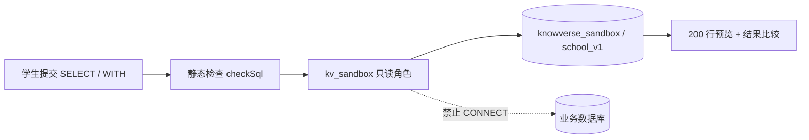

# SQL 练习沙箱

2026-11-17。实现：`src/server/sandbox.ts`；数据与授权：`sandbox/setup.ts`、`sandbox/datasets.sql`。



每次执行 `BEGIN READ ONLY`，设置事务局部 `statement_timeout=2000ms` 与白名单 `search_path=school_v1`，包装为子查询、最多读取 201 行，取前 200 行后 `ROLLBACK`。多出的第 201 行用于标记截断；截断结果不能判为完整答案相等。SQL 错误转为 `sql_error`，超时显示“查询超时（2 秒）”，连接随后回滚归还连接池。

三层防线：静态检查仅接受单条 SELECT/WITH、最多 4000 字符、拒绝一组危险函数及 COPY；事务层强制只读与超时；数据库层使用独立库、只读角色、业务库撤销 CONNECT。应用角色、库所有者与沙箱角色不能混用。

## 安全用例

`tests/sandbox.test.ts` 的编号如下（静态测试始终执行；真实执行组在未配置 `SANDBOX_DATABASE_URL` 时跳过，CI 必须配置）。

| 编号 | 输入/场景 | 断言 |
|---|---|---|
| S1 | DROP TABLE | sql_not_select |
| S2 | DELETE | sql_not_select |
| S3 | UPDATE | sql_not_select |
| S4 | INSERT | sql_not_select |
| S5 | SELECT 1; SELECT 2 | sql_multi |
| S6 | SELECT pg_sleep(5) | sql_forbidden |
| S7 | COPY ... TO 文件 | sql_forbidden |
| S8 | SELECT relname FROM pg_catalog.pg_class LIMIT 1 | 可读系统目录元数据，不声称完全隐藏目录 |
| S9 | 空输入、超过 4000 字符 | sql_empty / sql_too_long |
| S10 | 注释、字符串内分号 | 合法 SELECT 保留 |
| S11 | count(students)、事务只读设置 | 6 行；transaction_read_only=on |
| S12 | 写入 CTE；错误后再查询 | sql_error；数据不变、连接可继续用 |
| S13 | 非白名单数据集、业务 users 表 | sandbox_dataset / sql_error |
| S14 | 205 行结果 | 仅返回 200 行且 truncated，禁止判等 |

原有 `tests/practice-growth.test.ts` 另验证只读角色连接业务库被拒绝、长查询实际触发 2 秒超时。这两个集成检查没有用所有者连接冒充沙箱权限。

## 等价判定

| 编号 | 场景 | 断言 |
|---|---|---|
| E1 | 行序不同、重复行 | 无序模式按多重集比较，重复次数必须一致 |
| E2 | NULL | 仅与 NULL 相等，与 0 / 空字符串 / "null" 不等 |
| E3 / E3b | 0.1+0.2 与 0.3（内存及真实 float8 查询） | 默认绝对误差 ≤1e-6；超差拒绝 |
| E4 | 别名与结果维度 | 忽略列名，列数/行数一致 |
| E5 | ordered=true | 必须保持行序 |
| E6 | 容差区间重叠的多行 | 增广匹配处理重新分配，不因贪心顺序误判 |
| E7 | number / 文本 / 大整数文本 | 类型不混淆，不将 bigint 转成有损 Number |
| E8 | 空结果、无穷大 | 两空结果相等；无穷大与有限值不等 |

无序比较使用二分图匹配，保留重复行；200 行上限内运行。列位置仍有意义；有序模式按位置比较。`eps` 可传入非负有限数。

边界：pg 默认将 PostgreSQL `numeric` / `bigint` 返回为字符串，本实现按精确文本比较；容差用于 JS number（如 float4/float8），不会把任意文本强制转换为数字。当前题库主要为计数与连接题；新增高精度小数题时应先定义精度与类型契约。

## 复现与局限

```powershell
npm test -- tests/sandbox.test.ts tests/practice-growth.test.ts
npm run security:audit
```

2026-11-17：新增沙箱文件 23 例通过，原练习/成长文件 12 例通过；全量结果见 `../test-report.md`。

静态检查是正则处理，**不是 SQL AST 或完备的函数白名单**。注释标记出现在字符串中、特殊引号等 SQL 词法情形可能误拒绝；只读事务不能阻止所有昂贵计算，2 秒超时也不是 CPU/内存硬配额。目录元数据可见，沙箱同一实例部署也不是操作系统隔离。独立库不应存放业务数据，也不应安装允许外连/文件访问的额外扩展。面向不受信任的公网负载前，还需要查询并发/速率限制、资源配额和更严格解析。这些边界不因本组测试通过而消失。
