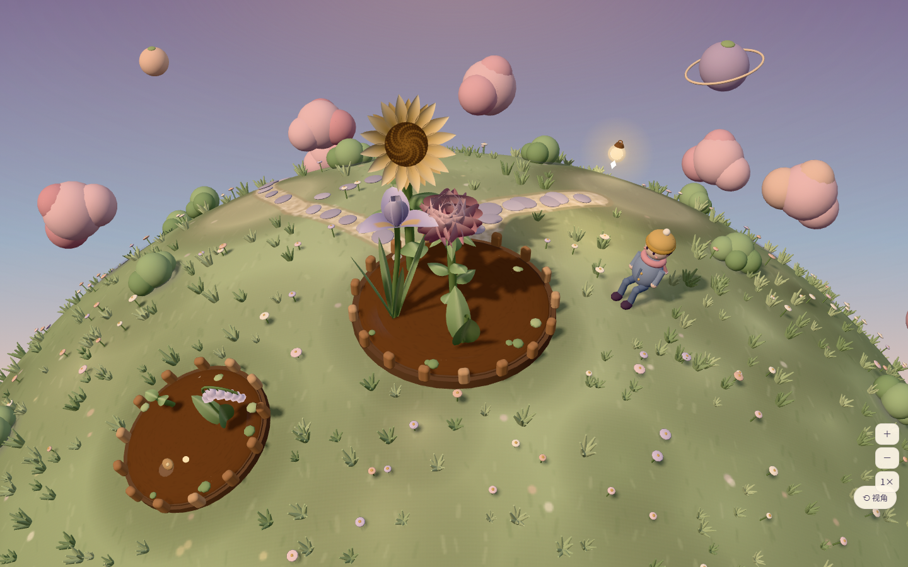
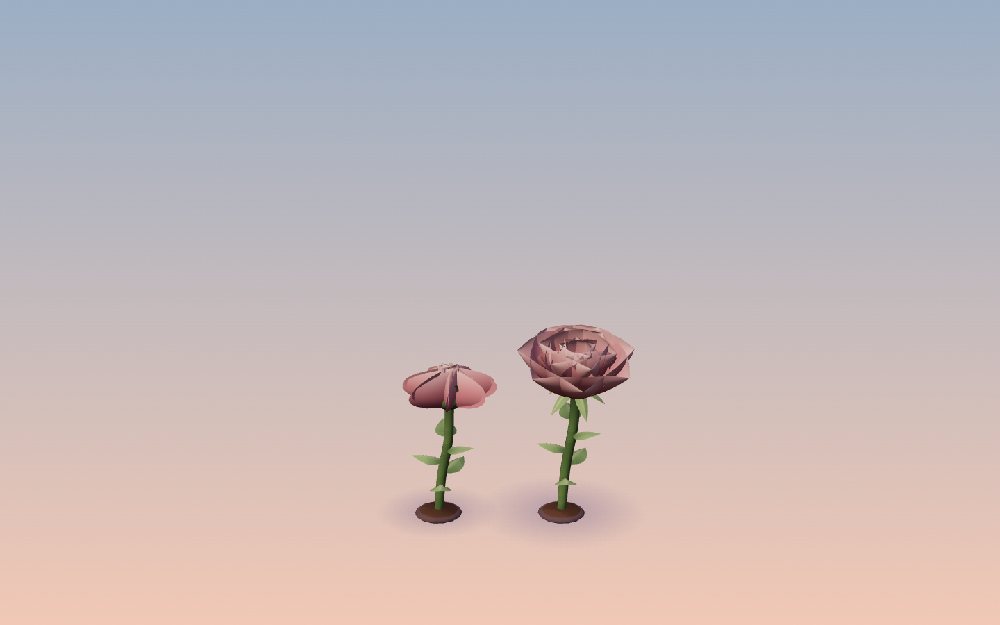
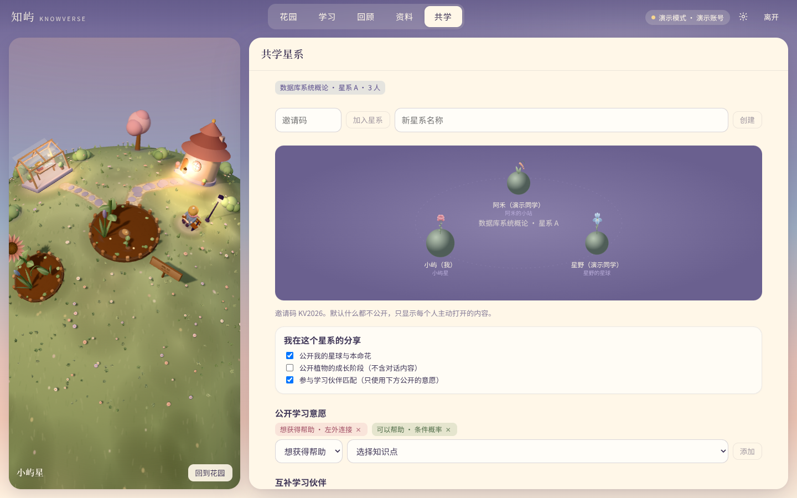
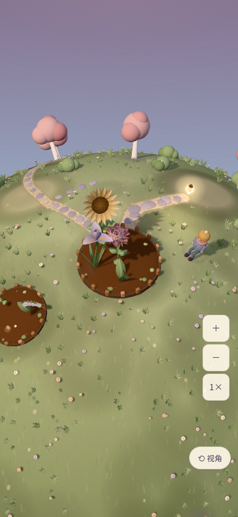

# 四页视觉讲解素材

2026-11-17。本文件供讲解时选图与组织讲法，不生成报告或 PPT。图片来自项目真实运行；建模前后来源见 [B1 对比索引](screenshots/ui/b1-comparison.md)。

## 第 1 页：风格与材质

暮紫、奶油白、草绿、玫瑰粉和蜂蜜金组成绘本色板。哑光材质、暖主光与冷补光共同塑造微缩模型感；界面将对话和表格放在纸张面板中，避免文字直接压在模型上。图中的花园为开发 fixture，非真实用户数据。

讲法：星球让个人空间有位置感，花圃表达学科，植物对应知识点；学习依据仍来自数据库，视觉只是解释已有记录。

## 第 2 页：建模与阶段

四种花使用程序化几何；种子、嫩芽、生叶、花苞、开花表达产品规则。种子与嫩芽仍共用模型；旅人没有骨骼行走动画。温室与书屋是资料、学习的场景入口，普通导航提供相同功能。

讲法：成长依据是提问、阅读、笔记和作答等记录；引导、独立、变式与提示使用影响阶段，用户可查看及撤销证据。不能把开花描述为经科学测量的知识掌握程度。

## 第 3 页：星系与只读参观

个人花园为 3D，班级星系为 2D SVG 星图；3D 多球环绕未实现。只有本人和主动分享的成员出现在成员星球数据中，未分享者只计人数。只读参观、阶段公开与伙伴匹配分别受分享开关控制；图为既有截图，本轮权限已通过 HTTP + kv_app 复测。

讲法：先说明隐私规则，再展示入口。后续 3D 方案仍应复用同一 API 和分享规则；本轮不承诺 3D 环绕和性能帧率。

## 第 4 页：手机、低动效与降级

桌面 1440×900、手机 390×844 对照；WebGL 不可用时使用静态绘本。低动效减少相机、粒子与自转动画，文字、资料、判题和学习卡仍通过普通界面操作。DPR 上限、纹理大小与实例化预算见 [视觉说明](visual-redesign.md)。

讲法：本轮截图来自 Windows Edge + SwiftShader，不能代表真实 GPU/手机性能。无横向溢出是截图视口的检查结果，不等同于真机可用性或屏幕阅读器验收。
